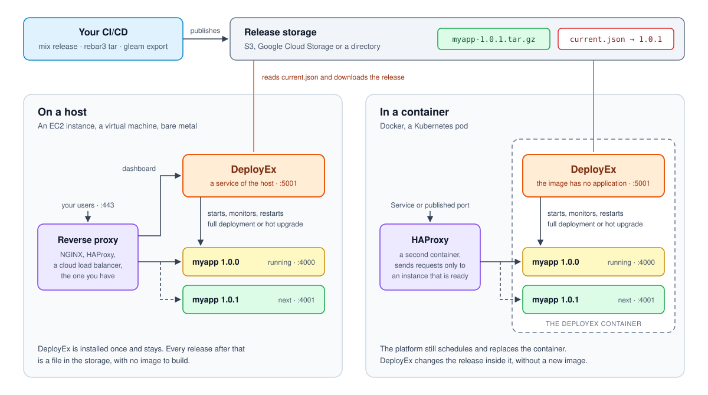
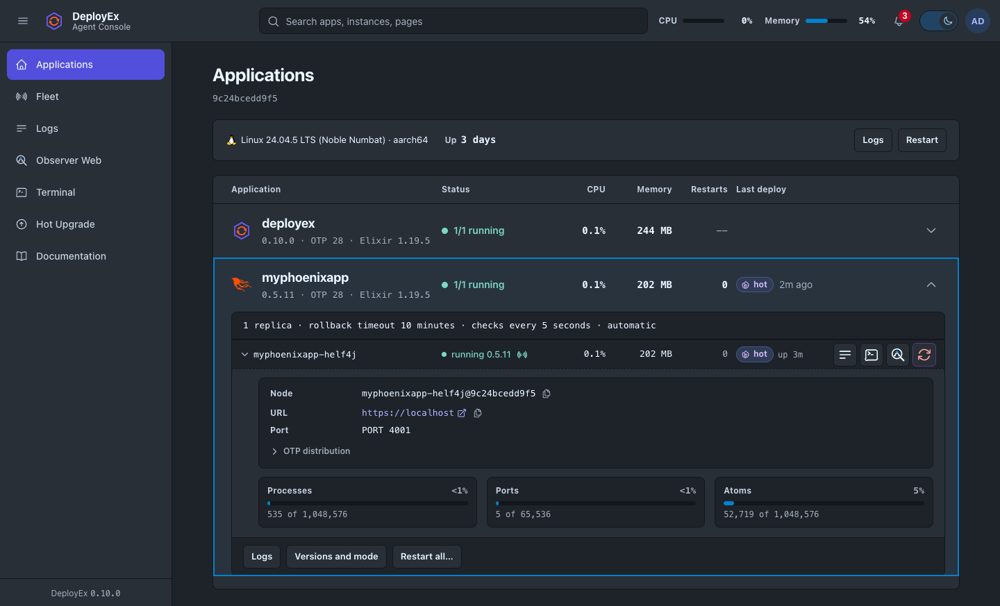
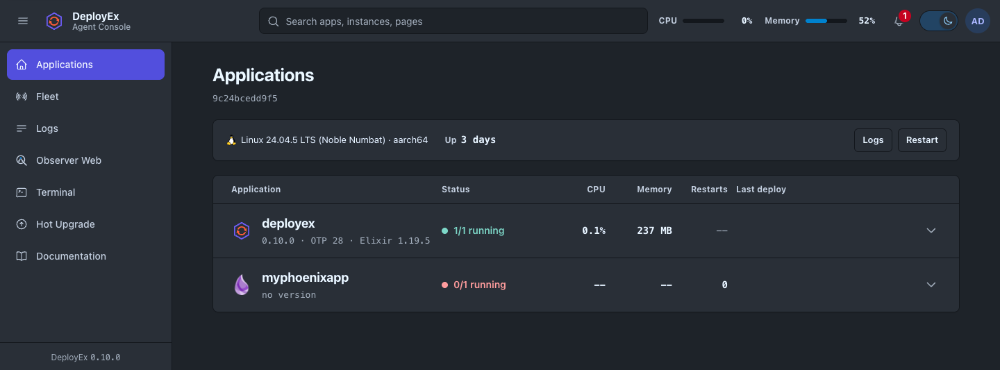

# DeployEx

> Who supervises the supervisor (of your application)?

 [](https://github.com/deployex/deployex/actions/workflows/pr-ci.yaml) [](LICENSE.md) [](.github/workflows/pr-ci.yaml) [](.tool-versions)

Every pull request runs the full test suite with a 94% coverage gate, Credo in strict mode, Dialyzer, Sobelow, and a `mix hex.audit` / `mix deps.audit` dependency check, see [`pr-ci.yaml`](.github/workflows/pr-ci.yaml).

DeployEx is a lightweight tool that deploys and runs Beam applications (Elixir, Gleam and Erlang) from their release package. It executes a full deployment or a hot-upgrade, depending on the package's content, and leverages OTP distribution for monitoring and data extraction. It runs where your application runs: as a service on a host, bare metal or a virtual machine, or inside a container, on Docker or Kubernetes.

DeployEx acts as a central deployment runner, gathering crucial deployment data such as the current version and release package contents. The content of the release package enables it to run for a full deployment or a hot-upgrade. Meanwhile, on the development front, your CI/CD pipeline takes charge of crafting and updating packages for the target release. This integration ensures that DeployEx is always equipped with the latest packages, ready to facilitate deployments.

To learn more about where DeployEx comes from, and what the release of a Beam application can do by itself, check out the talk [Bring back the power of Beam deployments with DeployEx](https://www.youtube.com/watch?v=MV4ROe6xmlI) at CODE BEAM America 2025.



Upon deployment, the following dashboard becomes available, providing easy access to logs, the terminal, process observability, and much more for both DeployEx and the monitored applications.



## 🚢 Two ways to run it

The release, the YAML and the dashboard are the same in both. What changes is what is around DeployEx.

| | On a host | In a container |
|---|---|---|
| Where | An EC2 instance, a virtual machine, bare metal | Docker, a Kubernetes pod |
| DeployEx is | A service of the host, installed and upgraded by a [script](/devops/installer/deployex.sh) | An image with DeployEx and no application |
| In front of the application | The proxy you have: NGINX, HAProxy, a cloud load balancer | HAProxy as a second container, which sends requests only to an instance that is ready |
| A release of the application | A file in the release storage | A file in the release storage, with no new image |
| What replaces the host or the container | You, or an autoscaler | The platform, as it does today |
| Where to start | The cloud guides, with Terraform for [AWS](guides/docs/aws-elixir/README.md) and [GCP](guides/docs/gcp-elixir/README.md) | [DeployEx in a container](guides/docs/docker/README.md) |

On a host is where DeployEx started.
In a container is newer: it was run with Docker and on a local Kubernetes cluster, and the guide has what was seen and what is still open.

### Try it with Docker

It needs Docker and `make`, and nothing else on your machine:

```bash
git clone https://github.com/deployex/deployex && cd deployex
make docker-up     # DeployEx and HAProxy. The dashboard is at http://localhost:5001, admin / deployex

git clone https://github.com/thiagoesteves/myphoenixapp ../myphoenixapp
make docker-app    # builds the sample application and publishes it. It answers at http://localhost:8080
```

Change the application, set the next version in its `mix.exs` and run `make docker-app` again: DeployEx applies it as a hot upgrade, in the same OS process.
The rest is in [DeployEx in a container](guides/docs/docker/README.md).

## 🧭 Is it for your project?

DeployEx runs the release of a BEAM application on a host and keeps it running: it starts it, watches it, restarts it, deploys the next version and goes back when that one does not hold.
On a host it takes the place of the container and the orchestrator, for applications that are better served by the node staying up.
In a container it works inside what the platform already schedules, and a release of the application no longer replaces the container.

What a restart costs is the same for every team: the connections that were open, what the node held in memory, the work it was doing.
How often you release decides what you get back.

 * **You release many times a week, because the code moves fast.** Each release is a restart today, so availability goes down as the team gets faster. With hot upgrades most releases are not restarts, and shipping more stops costing more.
 * **You release once a week, or less.** Each release carries more, and leaves you the time to prepare it as an upgrade: read what changes, write the instructions the generator cannot, apply it on staging first. The release of the week goes out in the middle of the day, without a maintenance window.

 * **You have a fix that cannot wait for the next release.** Every team ships hotfixes, whatever its cadence, and a hotfix is the smallest release there is. As a hot upgrade it is loaded into the running nodes in seconds, when it is needed, without restarting everything to change a few lines.

Either way you also get one place for the logs, a shell, the processes and the versions of every node, and a node that is restarted when it crashes and taken back to the previous version when a new one does not hold.

**It does not replace your observability tools.**
Datadog, Honeycomb, Grafana and the like keep doing what they are for: history, alerts, traces across services.
DeployEx gives you the fast view that sits next to the deployment, with nothing to instrument and nothing to set up: the memory, processes, ports and atoms of each node, its applications and its processes, the live logs, a shell.
It is what you open to see what a node is doing right now, and it works with those tools: a hot upgrade moves the version on traces and logs, so they keep telling one release from the next.
DeployEx's own request latency and VM metrics are also at `GET /metrics`, in Prometheus exposition format, for your existing scraper to pick up instead of only living in the dashboard.

What it asks for:

 * **A place where the node can stay**: a host or a virtual machine, in a cloud or not, or a container. DeployEx runs the release there, and a hot upgrade changes the code of the node that was running. A container that is replaced, for a new image of DeployEx or a node that is drained, is still a restart: it comes back on the version `current.json` points at.
 * **A release storage** that DeployEx can read: S3, Google Cloud Storage or a directory.
 * **Clustering across hosts is yours, or DeployEx's.** DeployEx connects the nodes of a host to each other. With `peers_dns_query` in the [YAML](guides/docs/yaml/README.md) it also connects to the DeployEx of the other hosts or pods, and the applications they run are then connected to each other too.

An application that holds nothing, where a rolling restart behind a load balancer is already invisible, has little to gain from hot upgrades, and still gets the rest.

**Hot upgrades are a choice for each release, not a commitment.**
Every release can be deployed in full, and that is what DeployEx does unless the release carries what a hot upgrade needs.
When it does, DeployEx applies it to the running node, and falls back to a full deployment when it cannot.
A release with a new Erlang or Elixir, or a library with native code, is always a full deployment.

**Preparing a release as an upgrade is work a coding agent can do.**
Reading what changed in the code and in each dependency, and writing the few instructions the generator cannot, is what the [skills of the guide](https://github.com/deployex/beam-hotupgrades#skills-for-coding-agents) are for.
What it produces does not have to be taken on trust: the upgrade is applied to a real node in CI, and DeployEx keeps the relup of every upgrade and what each step did, on the Versions page.

What a hot upgrade asks of an application, what one real release looked like and the questions that come first are in [Before you decide](https://github.com/deployex/beam-hotupgrades#before-you-decide), in the guide that covers the mechanism for any tool.
What DeployEx adds to it is in [Hot-Upgrades](guides/docs/hot-upgrades/README.md).

## 🔉 Features

- Monitors multiple Beam application nodes (Elixir/Erlang/Gleam) and automatically restarts them if they crash for any reason.
- Includes a backoff delay restart mechanism to prevent excessive restarts.
- Performs full deployments based solely on the release files generated by:
  - `mix release` for Elixir.
  - `gleam export` for Gleam.
  - `rebar3 as prod tar` for Erlang.
- Supports hot code reloading for:
  - Elixir application (and libraries) using the [Jellyfish][jyf] library.
  - Elixir umbrella applications (and libraries) using the [Jellyfish][jyf] library.
  - Erlang application, umbrella application, and libraries using the [rebar3_jellyfish_plugin][r3jyf] plugin.
  - DeployEx (and libraries) itself (Isn't that awesome?)
- Supports the following cloud providers (with terraform files):
  - Amazon Web Services (AWS)
  - Google Cloud Platform (GCP)
- Supports automatic TLS certificate provisioning, deployment, and renewal:
  - Supports Let's Encrypt ACME v2 with DNS-01 challenge validation.
  - Supports fully automated per-application certificate lifecycle management directly from the YAML configuration.
  - Supports wildcard domain certificates (e.g. `*.example.com`) through configurable DNS providers (rout353 and cloudflare).
  - Supports automatic certificate import/export workflows for cloud providers such as AWS ACM/Route53.
  - Automatically renews certificates before expiration with configurable renewal thresholds and validation intervals.
- Supports external alerting for deployment lifecycle events via configurable notification channels:
  - Webhook — generic HTTP POST to any endpoint (n8n, Zapier, custom scripts, etc.)
  - Slack — formatted Incoming Webhook messages with per-event emoji and mrkdwn.
  - PagerDuty — Events API v2 incidents with automatic severity mapping.
- Runs on a host, bare metal or a virtual machine, or in a container on Docker or Kubernetes, see [DeployEx in a container](guides/docs/docker/README.md).
- Supports local environments for non-cloud deployments
- Connects to the DeployEx of other hosts or pods, deploys an application on one of them at a time, and shows all of them on the Fleet page.
- Supports readiness and liveness probes for the monitored applications, over OTP or HTTP.
- Gives an application time to stop by itself before it is killed (time configurable).
- Provides rollback functionality if a monitored app version remains unstable for 10 minutes (time configurable).
- Rolled-back monitored app versions are ghosted, preventing their redeployment.
- Ensures all nodes remain connected to the OTP distribution, including DeployEx itself.
- Supports OTP distribution with mutual TLS (mTLS) for secure monitoring of apps and DeployEx.
- Provides the ability to run pre-commands prior deployments for Database migrations or any other eval command.
- Provides a friendly UI that only authenticated users can access, with admin and read-only roles:
  - The admin user and its password.
  - GitHub sign-in, for the emails and domains of an allow-list.
  - Cloudflare Access, with the groups of your identity provider.
- Provides an [API for agents and pipelines](guides/docs/agent-api/README.md), with tokens and scopes.
- Allows setting a previously configured version in the UI, enabling DeployEx to enforce deployment of a specific version.
- Supports individual application restarts via the UI, including DeployEx itself.
- Shows the URLs each connected application is serving on, read from the application itself.
- Provides easy access to the application shell:
  - IEx shell for monitored Elixir apps and DeployEx.
  - Erlang shell for monitored Gleam/Erlang apps.
- Provides monitoring and restart mechanisms for host memory thresholds and beam statistics, including port, atom, and process metrics, for monitored applications and for DeployEx itself.
- Exposes its own request latency and VM metrics at `GET /metrics`, in Prometheus exposition format.
- Supports access to live log files (stdout and stderr) for both monitored apps and DeployEx.
- Supports observability for all connected applications via [Observer Web][owb].
- Supports safe tracing for all connected applications.
- Provides visualization of Host System memory and CPU usage.
- Provides easy access to the host shell (tmux).
- Provides script to be used with ubuntu/debian hosts, amd64 or arm64, to install/update and hotupgrade DeployEx.
- Provides status information per node:
  - OTP connectivity
  - Version history
  - Last deployment status
  - Number of crash restarts
  - Number of forced restarts
- And much more ...

> [!NOTE]
> The cloud examples in this project use NGINX as a reverse proxy and load balancer, and the container setup uses HAProxy. DeployEx depends on neither: any proxy that can reach the ports of the application works, and one that checks each port before it sends a request, as HAProxy does, sends none to an instance that is still starting.

## ⚠️ What is coming next? 

[Roadmap](https://github.com/users/thiagoesteves/projects/4)

## 📁 Getting Started

Since OTP distribution is heavily used between the DeployEx and Monitored Applications, users must ensure that both applications are running the same OTP Major version to prevent compatibility issues and system malfunctions. DeployEx releases will contain binaries for the following OTP versions:

| DeployEx version                                                          |  |  |
| ------------------------------------------------------------------------- | ---------------------------------------------------------- | ---------------------------------------------------------- |
| :soon: [**1.0.0**](https://github.com/deployex/deployex/releases/tag/1.0.0)   | **28.5.0.8**                                               | **29.1.2**                                                 |
| [**0.10.0**](https://github.com/deployex/deployex/releases/tag/0.10.0) | **28.5.0.6**                                               | **29.0.6**                                                 |

### Running the application

> [!TIP]
> Common dev tasks are wrapped in a `Makefile`. Run `make help` to list them (`make start`, `make test`, `make dev-tls` for TLS distribution, and `make dev-app` to build and publish a local sample app for monitoring/log testing).

You can kickstart the setup with the following commands, the default number of replicas is 3:

```bash
mix deps.get
iex --sname deployex --cookie cookie -S mix phx.server
Erlang/OTP 29 [erts-17.1.1] [source] [64-bit] [smp:10:10] [ds:10:10:10] [async-threads:1] [jit]

[info] Initializing Host Memory Server
[info] Initializing HotUpgrade server                                                                                                         
[info] Initializing Engine Server for myphoenixapp
[info] Initializing ConfigWatcher for YAML configuration
[info] Initializing Watchdog Server
[info] Running DeployexWeb.Endpoint with Bandit 1.14.1 at 127.0.0.1:5001 (http)
[info] Access DeployexWeb.Endpoint at http://localhost:5001
Interactive Elixir (1.20.5) - press Ctrl+C to exit (type h() ENTER for help)
[watch] build finished, watching for changes...

Rebuilding...

Done in 993ms.
[error] Error downloading release version for myphoenixapp, reason: {:error, :enoent}
[warning] No versions set yet for myphoenixapp
```

Now you can visit [`localhost:5001`](http://localhost:5001) from your browser and sign in as the admin user, _**username: admin password: deployex**_. In development the sign-in page comes with them filled in. If something else on your machine listens on 5001, start DeployEx with `DEPLOYEX_PORT` set to another port. You should expect a dashboard like this one, with DeployEx running and the application waiting for a version:



> [!NOTE]
> The error message in the CLI is due to no monitored app is available to be deployed. If you want to proceed for a local test, follow the steps at [Local Development & Application Setup](#-local-development--application-setup), or run `make dev-app`. Also, it is important to note that the distribution will be required so this is the reason to add `-sname deployex` in the command

### How DeployEx handles monitored application Version/Release

The DeployEx app expects a `current.json` file to be available, which contains version, hash information and any pre-command. This file is mandatory for full deployment and hot upgrades.

#### Version file (current.json)

Expected location in the release folder:

```bash
# production path
./{bucket}/versions/{monitored_app}/{env}/current.json
# local test path
/tmp/deployex/bucket/versions/{monitored_app}/{env}/current.json
```

Expected JSON format for `current.json`:

```json
{
  "version": "1.0.0",
  "pre_commands": ["eval MyApp.Migrator.create", "eval MyApp.Migrator.migrate"], // optional field
  "hash": "local"
}
```

Each pre-command of an Elixir app runs in a shell as `bin/<monitored_app> <pre-command>`. Quote an expression that has parentheses or spaces, for example `"eval 'MyApp.Release.migrate(:all)'"`.

Once the file is captured, the deployment will start if no app is running or if the current app is running with a version that differs from the `current.json` file.

#### Release package

Expected location in the release folder:

```bash
# production path
./{bucket}/dist/{monitored_app}/{monitored_app}-{version}.tar.gz
# local test path
/tmp/deployex/bucket/dist/{monitored_app}/{monitored_app}-{version}.tar.gz
```

## 🛠️ Production Information

### Environment Variables

DeployEx application typically requires a few environment variables to be defined for proper operation. Ensure that you have the following environment variables set when running in production:

| ENV NAME                           | EXAMPLE                          |             SOURCE | DESCRIPTION                                               |
| ---------------------------------- | -------------------------------- | -----------------: | --------------------------------------------------------- |
| **DEPLOYEX_SECRET_KEY_BASE**       | 42otsNl...Fpq3dIJ02              | aws, gcp or env secrets | secret key used for encryption                            |
| **DEPLOYEX_ERLANG_COOKIE**         | cookie                           | aws, gcp or env secrets | erlang cookie                                             |
| **DEPLOYEX_ADMIN_HASHED_PASSWORD** | 2b1...42ASi                      | aws, gcp or env secrets | Hashed admin password for authentication                  |
| **DEPLOYEX_OAUTH_CLIENT_SECRET**   | 3f9c...a1b2                      | aws, gcp or env secrets | Optional, the GitHub OAuth App secret when `auth` is set  |
| **DEPLOYEX_API_TOKENS**            | ci:read:9f86...0f00a08           | aws, gcp or env secrets | Optional, the [agent API](guides/docs/agent-api/README.md) token entries |
| **DEPLOYEX_CONFIG_YAML_PATH**      | /home/ubuntu/deployex.yaml       |         system ENV      | Yaml configuration for Deployex and Monitored application |
| **DEPLOYEX_OTP_TLS_CERT_PATH**     | /usr/local/share/ca-certificates |         system ENV      | If using mTLS, the certificate PATH is needed             |

Once DeployEx runs, it fetches the configuration from the YAML file described in the session [YAML Management](guides/docs/yaml/README.md).

> [!NOTE]
> For local testing, these variables are not expected or set to default values.

### ☁️ Cloud Providers

DeployEx offers a comprehensive set of Terraform examples for programmatically deploying in AWS and GCP, including detailed step-by-step setup instructions:

- [AWS deployment for Elixir (without ecto)](guides/docs/aws-elixir/README.md)
- [AWS deployment for Elixir (with ecto and certificate manager)](guides/docs/aws-elixir-db-certificate/README.md)
- [GCP deployment for Elixir](guides/docs/gcp-elixir/README.md)
- [AWS deployment for Gleam](guides/docs/aws-gleam/README.md)

### Installation

For a container, the image is built from [`devops/docker`](/devops/docker), see [DeployEx in a container](guides/docs/docker/README.md).

If you intend to install DeployEx directly on an Ubuntu/Debian server, you can utilize the [deployex script](/devops/installer/deployex.sh) provided in the release package. This script is able to `install`, `update` and `hot-upgrade` DeployEx. However, you have the option to manually compile and install DeployEx on your target system.

For a host with no internet route, the script can install and upgrade DeployEx from a private S3 bucket,
see [AWS hosts with no internet route](guides/docs/aws-air-gapped/README.md).

For more information, please check [YAML Management](guides/docs/yaml/README.md) details.

#### 🔥 Hot-Upgrades

For more information, please check [Hot-Upgrades](guides/docs/hot-upgrades/README.md) details.

### Pre-commands (Elixir only)

Your application will likely require database commands, such as migrations. DeployEx handles these through pre-commands specified in `current.json` under the `pre_commands` field. These commands will be executed in the order they are listed, before the application starts. If a pre-command fails, the release is not installed on that instance: a hot upgrade ghosts the version at once, and a full deployment retries until `deploy_rollback_timeout_ms` and then ghosts it. A hot upgrade gives its pre-commands up to `deploy_rollback_timeout_ms` from the moment they start. If they run longer, DeployEx stops them and ghosts the version. If they cannot start, or the application does not run again after them, DeployEx deploys the version fully instead, which runs the pre-commands, even if they already ran. If a pre-command is needed and does not require changes to the application itself, using pre-commands in conjunction with hotupgrade is ideal to avoid unnecessary downtime.

### 🔐 Secrets Requirements

DeployEx retrieves its secrets from a Secret Manager (AWS, GCP, or local) through the config provider. The configuration requires specifying the adapter and the secret path. These information is set via the [YAML File](guides/docs/yaml/README.md), For example:

```yaml
# Secrets Management
secrets_adapter: "aws"                                   # Secrets adapter: aws, gcp, env, 1password-connect or 1password-cli
secrets_path: "deployex-myphoenixapp-prod-secrets"       # Secret path to retrieve from
```

Within the secrets, the following key-value pairs are required:
| ENV NAME | EXAMPLE | DESCRIPTION |
|----------|-------------|------|
| **DEPLOYEX_SECRET_KEY_BASE** | 42otsNl...Fpq3dIJ02 | mix phx.gen.secret |
| **DEPLOYEX_ERLANG_COOKIE** | my-cookie | erlang cookie |
| **DEPLOYEX_ADMIN_HASHED_PASSWORD** | $2b$1...5PAYTZjNQ42ASi | Bcrypt.hash_pwd_salt("my-pass") |
| **DEPLOYEX_OAUTH_CLIENT_SECRET** | 3f9c...a1b2 | Optional, the GitHub OAuth App secret, needed only when the YAML has an `auth` section |
| **DEPLOYEX_API_TOKENS** | ci:read:9f86...0f00a08 | Optional, `name:scopes:sha256` entries, needed only when the YAML has an `agent_api` section |

## 🏠 Local Development & Application Setup

Learn how to run DeployEx locally and configure your application for mTLS, hot upgrades, and metrics:

- [Elixir Application - No Ecto](guides/docs/local-elixir/README.md)
- [Elixir Application - With Ecto](guides/docs/local-elixir-ecto/README.md)
- [Elixir Umbrella Application - No Ecto](guides/docs/local-elixir-umbrella/README.md)
- [Gleam Application](guides/docs/local-gleam/README.md)
- [Erlang Application](guides/docs/local-erlang/README.md)
- [DeployEx in a container, with HAProxy in front](guides/docs/docker/README.md)

### Recommended Supporting Repositories

For local testing and development, check out these complementary repositories:

- [Elixir - myphoenixapp](https://github.com/thiagoesteves/myphoenixapp)
- [Elixir - myumbrella](https://github.com/thiagoesteves/myumbrella)
- [Elixir - ectoapp](https://github.com/thiagoesteves/ectoapp)

## 🔨 Troubleshooting

The dashboard has the logs and a shell of DeployEx and of every instance, and that is the place to look first.
The commands below are for when the dashboard cannot be reached, or DeployEx itself does not start.

### On a host

```bash
# The logs of DeployEx
tail -f /var/log/deployex/deployex-stdout.log
tail -f /var/log/deployex/deployex-stderr.log
journalctl -u deployex            # what systemd says about the service

# A shell in DeployEx
export RELEASE_COOKIE=cookie
/opt/deployex/bin/deployex remote

# The logs of an instance of a monitored app
export monitored_app_name=myphoenixapp
export sname="${monitored_app_name}-2l0rkp"
tail -f /var/log/monitored-apps/${monitored_app_name}/${sname}-stdout.log
tail -f /var/log/monitored-apps/${monitored_app_name}/${sname}-stderr.log
```

### In a container

DeployEx writes its logs to the output of the container, with the logs of the applications when `monitored_app_log_stdout` is set.
The paths inside the container are the ones of a host, so everything else is the same after `exec`:

```bash
# Docker, from the root of this repository
docker compose -f devops/docker/compose.yaml logs -f deployex
docker compose -f devops/docker/compose.yaml exec deployex bash

# Kubernetes
kubectl logs -f deploy/deployex -c deployex
kubectl exec -it deploy/deployex -c deployex -- bash

# Then, inside the container
RELEASE_COOKIE=cookie /opt/deployex/bin/deployex remote
tail -f /var/log/monitored-apps/myphoenixapp/*-stdout.log
```

A container that is killed while the application starts is usually out of memory, see [On Kubernetes](guides/docs/docker/README.md#on-kubernetes) for the limit of open files that causes it.

### Running locally, in development

DeployEx runs in your terminal, so its logs and its shell are there. The files of the applications are under `/tmp/deployex`:

```bash
tail -f /tmp/deployex/varlog/${monitored_app_name}/${sname}-stdout.log
tail -f /tmp/deployex/varlog/${monitored_app_name}/${sname}-stderr.log
```

### Connecting to a monitored app manually

The paths are for a host or a container. In development, replace `/var/lib/deployex` with `/tmp/deployex/varlib`.

#### Elixir

```bash
export monitored_app_name=myphoenixapp
export sname="${monitored_app_name}-v636fq"
export RELEASE_NODE=${sname}
export RELEASE_COOKIE=cookie
/var/lib/deployex/service/${monitored_app_name}/${sname}/current/bin/${monitored_app_name} remote
```

#### Gleam

```bash
export monitored_app_name=mygleamapp
export sname="${monitored_app_name}-v636fq"
export hostname=???? # The host name of the machine or of the container
export ssl_options="-proto_dist inet_tls -ssl_dist_optfile /tmp/inet_tls.conf" # If enabled
erl -remsh ${sname}@${hostname} -setcookie cookie ${ssl_options}
```

#### Erlang

```bash
export monitored_app_name=myerlangapp
export sname="${monitored_app_name}-ly8tmo"
export RELX_REPLACE_OS_VARS=true
export RELEASE_NODE=${sname}
export RELEASE_COOKIE=cookie
export RELEASE_SSL_OPTIONS="-proto_dist inet_tls -ssl_dist_optfile /tmp/inet_tls.conf" # If enabled
/var/lib/deployex/service/${monitored_app_name}/${sname}/current/bin/${monitored_app_name} remote_console
```

## ❓How DeployEx handles services

DeployEx operates by monitoring applications and versions using folders and files, treating the monitored app as a service:

```bash
# test environment
/tmp/deployex/varlib/service/${monitored_app}/${sname}/previous/${monitored_app}
/tmp/deployex/varlib/service/${monitored_app}/${sname}/new/${monitored_app}
/tmp/deployex/varlib/service/${monitored_app}/${sname}/current/${monitored_app}
```

```bash
# on a host or in a container
/var/lib/deployex/service/${monitored_app}/${sname}/previous/${monitored_app}
/var/lib/deployex/service/${monitored_app}/${sname}/new/${monitored_app}
/var/lib/deployex/service/${monitored_app}/${sname}/current/${monitored_app}
```

## 🗨️ Getting involved

We'd love to have you contribute to the project! Follow **@deployex** on social media to stay updated:

[](https://www.linkedin.com/company/deployex) [](https://instagram.com/deployex) [](https://bsky.app/profile/deployex.bsky.social) [](https://x.com/deployex) [](https://www.youtube.com/@deployex) [](https://mastodon.social/@deployex)

You can also follow the creator/mantainer **Thiago Esteves**:

[](https://www.linkedin.com/in/thiago-cesar-calori-esteves-972368115/)

## ©️ Copyright and License

Copyright (c) 2024-2026, Thiago Esteves.

DeployEx source code is licensed under the [MIT License](LICENSE.md).

[jyf]: https://github.com/deployex/jellyfish
[r3jyf]: https://github.com/deployex/rebar3_jellyfish_plugin
[owb]: https://github.com/deployex/observer_web
