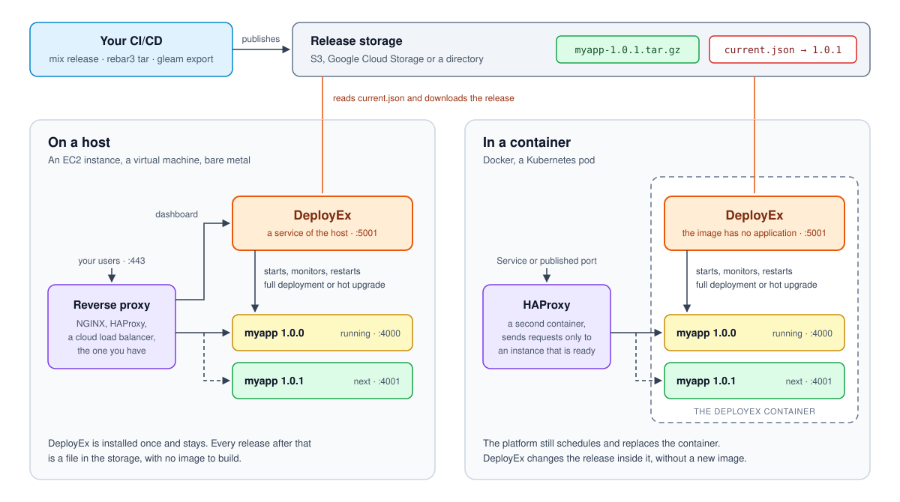

## Running DeployEx in a container

DeployEx shares a host with the applications it runs, or a container.
This guide is about the container, so that a team that deploys with containers gets hot upgrades without changing how it deploys: the container is still what the platform schedules, restarts and replaces, and DeployEx changes the code of the application inside it.

The setup has one container of DeployEx and one of [HAProxy](https://www.haproxy.org) that share a network, the way two containers of a Kubernetes pod do.
It runs with Docker alone, as one pod on a local Kubernetes cluster, and as several pods, which are the last two sections.
What it was run with, what was seen and what is still open are in each.



### How it is put together

```
                     the "pod": one network
      ┌──────────────────────────────────────────────────┐
 8080 │  HAProxy ──► 127.0.0.1:4000 or :4001              │
 ────►│                 ▲                                │
      │  DeployEx ──────┘ starts the application, and    │
 5001 │     ▲             upgrades it in place           │
 ────►│     │                                            │
      └─────┼────────────────────────────────────────────┘
            │
        ./bucket   the releases and current.json
```

 * **The image has DeployEx and no application.**
   The application comes from the bucket: a full deployment when the container starts, hot upgrades after that.
   A container that is replaced comes back on the version `current.json` points at.
 * **HAProxy gives the application one port.**
   DeployEx runs an instance on its base port plus 0 to `replicas`, and a full deployment starts the new instance on a free one before it stops the previous.
   One replica with a base of 4000 is on 4000 or 4001, and `haproxy.cfg` lists both.
 * **HAProxy only sends requests to an instance that is ready.**
   It asks each port every second, with a request, and a port gets traffic after two good answers and loses it after two bad ones.
   The trial asks for `/`.
   An application with a readiness path names it in `haproxy.cfg`, see [Ready for requests](#ready-for-requests).
 * **The files are in [`devops/docker`](https://github.com/deployex/deployex/tree/main/devops/docker)**: the `Dockerfile` of DeployEx, `compose.yaml`, `deployex.yaml`, `haproxy.cfg`, and `publish-app.sh` with the `Dockerfile.app-builder` it uses.

### 1. Start DeployEx and HAProxy

From the root of this repository:

```bash
make docker-up
```

The first build compiles DeployEx from the source, which takes a few minutes.
The dashboard is then at [http://localhost:5001](http://localhost:5001), user `admin` and password `deployex`.
It has no application yet, the bucket is empty.

### 2. Publish an application

The application needs what any application managed by DeployEx needs, see [Elixir Application - No Ecto](../local-elixir/README.md): a release with [Jellyfish](https://github.com/deployex/jellyfish) as one of its steps, and the TLS distribution turned on when `/tmp/inet_tls.conf` exists.
The sample application has both:

```bash
git clone https://github.com/thiagoesteves/myphoenixapp ../myphoenixapp
make docker-app
```

It publishes the version in the `mix.exs` of the application.
`APP_DIR`, `APP_NAME` and `VERSION` name another one: `make docker-app APP_DIR=../myapp APP_NAME=myapp`.
The script behind it, `devops/docker/publish-app.sh`, builds the release in a container, for the OS and the OTP of the DeployEx image, copies the tarball to `devops/docker/bucket` and writes `current.json`.
DeployEx sees it within a few seconds and deploys it:

```bash
make docker-logs
# Update is needed at sname:  from: <no current set> to: 0.5.1
# Full deploy instance: 1 sname: myphoenixapp-xi0vd1
# Application sname: myphoenixapp-xi0vd1 is running
```

The application answers through HAProxy at [http://localhost:8080](http://localhost:8080).

### 3. Hot upgrade it

Change the application, set the next version in its `mix.exs`, and publish it:

```bash
make docker-app
```

The build directory is kept in a volume, so this build finds 0.5.1 and Jellyfish writes the appups:

```bash
# Update is needed at sname: myphoenixapp-xi0vd1 from: 0.5.1 to: 0.5.2
# HOT UPGRADE version DETECTED - [%Deployer.HotUpgrade.Jellyfish{name: "myphoenixapp", ...}]
# Release upgrade executed with success at node: myphoenixapp-xi0vd1@... from: 0.5.1 to: 0.5.2
```

The instance and its OS process are the same as before.
A release with no appups, the first one built in a clean directory for instance, is a full deployment: a new instance on the other port, and the previous one stopped once the new one is running.

### The commands

| Command | What it does |
|---|---|
| `make docker-up` | Builds the image and starts DeployEx and HAProxy |
| `make docker-app` | Builds the application for the image and publishes it |
| `make docker-logs` | Follows the output of the DeployEx container |
| `make docker-down` | Stops and removes the containers |
| `make docker-clean` | Also removes the bucket and the build volumes of the application |
| `make k8s-up`, `k8s-logs`, `k8s-down` | The same as one pod on a local Kubernetes cluster, see [On Kubernetes](#on-kubernetes) |

### What was seen

With the sample application, on Docker 29 and an arm64 host, ten requests a second through HAProxy:

| Step | Result |
|---|---|
| The container starts with a version in the bucket | The application answered through HAProxy 15 seconds later |
| Hot upgrade | 261 requests, none failed. Same OS process before and after |
| Full deployment | 793 requests, none failed. The new instance on the other port, the previous one stopped 30 seconds later |
| The container removed and created again | Back on the same version in 13 seconds, read from the bucket |
| `docker compose stop` | Stopped in 12 seconds, exit code 0 |

### Ready for requests

An application that opens its port is not always one that can answer: it may still be warming a cache or waiting for a connection.
During a full deployment both instances are running, and a proxy that only looks at the port sends requests to the new one from the moment it listens.

To see it, the sample application was given a `/readyz` path that answers 503 for the first 20 seconds of the VM, and a full deployment was run twice, with ten requests a second:

| In front of the application | Requests answered by the instance that was not ready |
|---|---|
| A proxy that tries the next port when one refuses the connection | 96 of 792 |
| HAProxy with `/readyz` as its check | None of 793 |

With the check, the new instance had its first request 22 seconds after it started: the 20 seconds, and two answers a second apart.
Both instances answered for the next 8 seconds, until DeployEx stopped the previous one, and no request failed in either run.

Name the readiness path of your application in `haproxy.cfg`:

```
http-check send meth GET uri /readyz ver HTTP/1.1 hdr Host localhost
```

The check works on the way out too.
An application that makes its readiness path fail when it is asked to stop gets no new request while it shuts down.

### What to know before going further

 * **Both versions answer during a full deployment**, from the moment the new instance passes the check of HAProxy until DeployEx stops the previous one, 8 seconds in the run above.
   A release that answers its check and is still bad gets half of the requests for that long.
 * **The logs of the application are in the output of the container** because `deployex.yaml` sets `monitored_app_log_stdout: true`.
   An application writes to files under `/var/log/monitored-apps`, which DeployEx follows for its dashboard, and without that option `docker logs` and `kubectl logs` show DeployEx only.
   With it, what DeployEx reads is also written to its own output, without a prefix and one whole line at a time, so the lines of an application that logs JSON stay JSON and are not mixed with the lines of another application or of DeployEx itself, which are in the same output, as text.
   A line that has no end yet is written after a second.
 * **The log files are rotated by logrotate**, which the image installs, with the rule the cloud guides put on a host: 20 MB a file, seven kept, `copytruncate` since the application keeps its file open.
   A container has no cron, so `entrypoint.sh` runs it every five minutes next to DeployEx, `LOGROTATE_INTERVAL_SECONDS` to change that.
 * **`SHELL` has to be set.**
   erlexec, which runs the applications, does not start without it, and a container sets none.
   The `Dockerfile` sets it.
 * **The certificates are made when the image is built.**
   They are for the TLS distribution between DeployEx and the applications, and are enough for a trial.
   Mount your own at `/certs` for anything else.
 * **The state is in the container.**
   `/var/lib/deployex` holds the releases that were installed, the history and the ghosted versions.
   It is gone with the container, which then starts from `current.json`.
   Mount a volume there to keep it.
 * **One memory limit covers both.**
   DeployEx and the application are in the same container, and a full deployment has two instances of the application for a while.
 * **The image is built from the source**, since it has to be the same OS and the same OTP as the release of the application, and a published DeployEx release is for one of each.

### On Kubernetes

The same two containers as one pod, on a local cluster made with [kind](https://kind.sigs.k8s.io).
It needs `kind` and `kubectl` installed.

```bash
make k8s-up        # the cluster, the image, the ConfigMap, the Secret and the pod. Run it again after a change
make docker-app    # publishes to the same bucket, which the node mounts
make k8s-logs
make k8s-down
```

The dashboard is at [http://localhost:5011](http://localhost:5011) and the application at [http://localhost:8090](http://localhost:8090), through a NodePort Service.
The cluster has a kubeconfig of its own, `devops/docker/kubernetes/kubeconfig`, so the contexts of your `kubectl` are not read or changed: `export KUBECONFIG=$PWD/devops/docker/kubernetes/kubeconfig` to look at it.

What is in [`devops/docker/kubernetes`](https://github.com/deployex/deployex/tree/main/devops/docker/kubernetes):

 * **One Deployment with one replica and the `Recreate` strategy**, to keep the first run simple. [More than one pod](#more-than-one-pod) has what several of them need.
 * **`deployex.yaml` and `haproxy.cfg` in a ConfigMap, the three secrets of DeployEx in a Secret.**
 * **The readiness probe is on HAProxy**, a request to the application through it.
   HAProxy answers 503 while no instance passes its check, so the pod is ready when the application is, and not before one is published.
 * **The dashboard has a Service of its own**, with `publishNotReadyAddresses`, so it answers before an application is published and when a release is bad, which is when it is needed.
 * **A memory limit of 1.5 GB** on the DeployEx container, which covers DeployEx, the application and a second instance of it during a full deployment.
   DeployEx used 275 MB and the sample application 200 MB.
 * **The bucket is a directory of the node**, for the trial.
   On a real cluster it is `release_adapter: "s3"` or `"gcp-storage"`.

What was seen, with ten requests a second through the Service:

| Step | Result |
|---|---|
| The pod starts with a version in the bucket | Ready, 2 of 2 containers, 16 seconds later |
| Hot upgrade | 212 requests, none failed. The pod stayed ready and was not restarted |
| Full deployment | 695 requests, none failed. The pod stayed ready and was not restarted |
| `kubectl logs` of the DeployEx container | Has the lines of the application |
| The pod deleted | The new one ready 16 seconds after the delete, and no answer until then: there is one pod |

One thing only a cluster showed.
The first pod was killed for its memory every time the application started, with the limit at 1.5 GB.
A pod on containerd has a limit of open files of about a billion, where Docker gives a million, and the Erlang VM sizes its table of ports from that limit unless it is started with `+Q`.
DeployEx is, the applications it starts usually are not, and their VM asked for gigabytes when it booted.
`entrypoint.sh` now lowers the limit to 65536 before it starts DeployEx, which the applications inherit, `DEPLOYEX_MAX_OPEN_FILES` to change it.

The application can say it itself, which is the fix wherever it runs: `+Q 65536` in its `rel/vm.args.eex`, as in [Elixir Application - No Ecto](../local-elixir/README.md).
With a limit of 1048576 open files the sample application reported a limit of 1048576 ports without it, and 65536 with it, once the pod had restarted: a hot upgrade does not apply a flag of the VM.

### More than one pod

Each pod has its own DeployEx, which reads `current.json` by itself.
This is what makes several of them work together, all of it in the [YAML](../yaml/README.md) and the manifest:

 * **They find each other.**
   `peers_dns_query` names a headless Service that resolves to every pod, and each DeployEx connects to the others.
   The applications they run are then connected to each other too, with nothing in them for it.
   The pods of a Deployment have no host name that resolves from another pod, so `DEPLOYEX_NODE_HOST` names each node by the address of its pod:

   ```yaml
   # deployex.yaml
   peers_dns_query: "deployex-peers.default.svc.cluster.local"
   ```

   ```yaml
   # The headless Service, and the env of the DeployEx container
   apiVersion: v1
   kind: Service
   metadata:
     name: deployex-peers
   spec:
     clusterIP: None
     publishNotReadyAddresses: true
     selector:
       app: deployex
     ports:
       - name: epmd
         port: 4369
   ---
   env:
     - name: DEPLOYEX_NODE_HOST
       valueFrom:
         fieldRef:
           fieldPath: status.podIP
   ```

 * **They deploy one after the other.**
   The DeployEx that are connected deploy an application on one pod at a time, and the other pods keep serving the version they have meanwhile.
   A pod that runs nothing yet does not wait: every new pod starts what `current.json` points at.
 * **The Fleet page shows all of them**, from the dashboard of any pod: what each one runs, what it ghosted, which one is deploying and which ones wait.
   A deployment that holds the others back can be cancelled from there.
 * **One YAML for every pod.**
   The ConfigMap is mounted as a directory, so a change of it reaches the file of each pod without a restart.
   With `config_auto_apply: true` each DeployEx applies it when it reads it, and no one has to open the dashboard of each pod.
 * **A pod that is removed stops its application first.**
   DeployEx gives the application `shutdown_timeout_ms` to stop by itself.
   Give the pod at least as long, with `terminationGracePeriodSeconds`.
   An application that makes its readiness path fail when it is asked to stop gets no new request from HAProxy while it finishes the ones it has.

What was seen with two pods on the local cluster, a Phoenix application with a database and a migration as its pre-command, and twenty requests a second through the Service:

| Step | Result |
|---|---|
| Hot upgrade, with a migration | 983 requests, none failed. Both pods upgraded, and none restarted |
| Full deployment | 2,164 requests, none failed. One pod, then the other |
| A pod deleted | 778 requests, none failed. The application of that pod logged that it had stopped by itself |
| A value changed in the ConfigMap, with `config_auto_apply` | Applied by both DeployEx about 90 seconds later, with no restart |

Still open:

 * **Each pod has its own dashboard and its own state.**
   A Service sends a browser to any of them, and a session that was opened with the admin password is known by one pod only.
   The versions a pod ghosted are kept by that pod.
 * **It was run on a local cluster.**
   A cluster with several nodes, an autoscaler and a real release storage will show more.
